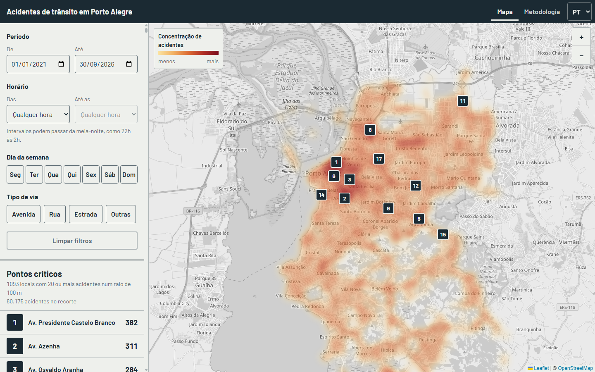
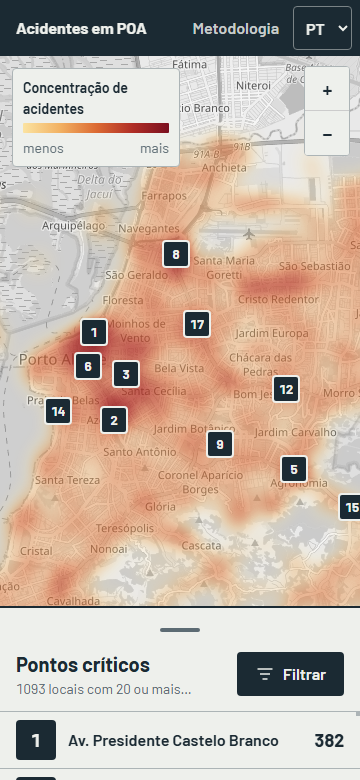
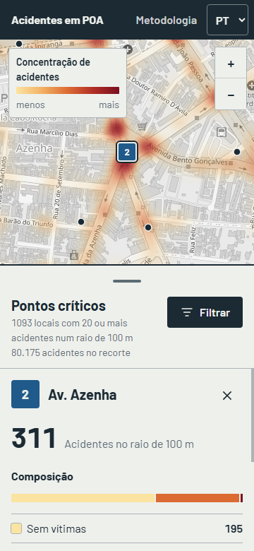
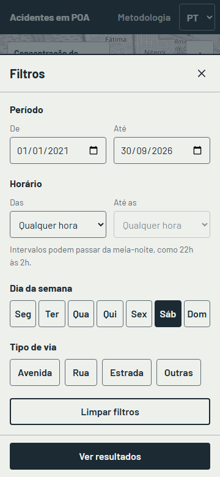

# Acidentes de trânsito em Porto Alegre

Sistema web que mostra os pontos críticos de acidentes de trânsito em Porto Alegre, a partir da base aberta da Prefeitura (#DataPoa / EPTC). Projeto de portfólio, com interface em português e inglês.

**No ar:** https://acidentes-poa.onrender.com (plano gratuito do Render: depois de um tempo parado, a primeira visita pode levar cerca de um minuto para carregar).



<p>
  
  
  
</p>

## O que o sistema faz

- Mapa de calor com os 80 mil acidentes registrados desde 2021 e os pontos críticos numerados.
- Filtros de período, horário, dia da semana e tipo de via, que combinam entre si.
- Ranking dos locais mais críticos, do maior para o menor número de acidentes, com "ver no mapa".
- Detalhe de cada ponto: quantidade, composição (sem vítimas, com feridos, com mortos) e período.
- Página de metodologia com fonte, critério, registros descartados e ressalva de uso.
- Celular primeiro: folha de ranking com três alturas e gaveta de filtros. No desktop, painel fixo à esquerda.

## Metodologia

- **Fonte:** conjunto [Acidentes de Trânsito – Acidentes](https://dadosabertos.poa.br/dataset/acidentes-de-transito-acidentes) do #DataPoa. Extração usada: 01/10/2026, com 87.323 registros de 01/01/2021 a 30/09/2026.
- **Limpeza:** 7.148 registros (8,2%) ficam fora do mapa. São 7.144 sem coordenada e 4 com data posterior à extração. Cada descarte fica salvo no banco com o motivo e o registro original.
- **Ponto crítico (RN-01):** local com 20 ou mais acidentes num raio de 100 m. O cálculo começa pelo acidente com mais vizinhos, forma o ponto e retira esses acidentes da disputa. Assim, cada acidente conta em um único ponto. O valor 20 saiu da [análise exploratória](notebooks/exploratory_analysis.ipynb).
- **Tipo de via:** a base não tem esse campo. A classificação usa a sigla do logradouro (AV, R, ESTR).
- **Gravidade:** campo UPS da EPTC (1 sem vítimas, 5 com feridos, 13 com mortos).
- **Ressalva:** os dados mostram ocorrências registradas. Um ponto alto indica concentração de registros, não culpa de condutores nem causa. O mapa não considera o volume de trânsito.

## Estrutura

O código é escrito em inglês. A interface tem português e inglês, e a documentação está em português.

```
backend/app/
  main.py            monta a aplicação (create_app): rotas, serviços e front compilado
  core/              configuração (caminhos, fonte dos dados, N e raio)
  domain/            regras de negócio puras, sem banco nem HTTP
    models.py        status, motivos de descarte, gravidade, tipos de via, entidades
    cleaning.py      validação e limpeza da base (M1, M2)
    filters.py       filtros combinados e período padrão (RN-03, RN-04)
    hotspots.py      pontos críticos por raio (RN-01)
    heatmap.py       células do mapa de calor
  repositories/      acesso ao SQLite (esquema, gravação e leitura das cargas)
  services/          casos de uso: base em memória, pontos críticos com cache, calor, metadados
  api/               camada HTTP: rotas, schemas Pydantic, dependências e erros
  pipeline/ingest.py baixa, valida e grava a base; gera relatório de carga
backend/tests/
  unit/              regras de domínio
  integration/       ingestão e API ponta a ponta
frontend/src/
  app/               shell: App, cabeçalho e rota por hash
  features/          uma pasta por funcionalidade, com componente, CSS Module e teste juntos
    dashboard/       painel principal: composição, folha de ranking e hooks de estado
    filters/         modelo dos filtros, formulário e gaveta do celular
    map/             mapa de calor, placas numeradas e legenda (Leaflet, carregado sob demanda)
    ranking/         ranking em faixas e tabela para leitor de tela
    hotspot-detail/  detalhe do ponto crítico
    methodology/     página de metodologia
  shared/            o que não pertence a uma funcionalidade
    api/             cliente, tipos do contrato e metadados
    hooks/           carregamento assíncrono, media query, foco preso em diálogo
    i18n/            configuração e traduções pt-BR e en
    lib/             formatação, armazenamento local, utilitários
    styles/          tokens da direção visual (seção 9.1) e estilos base
    ui/              botões, ícones e estados (carregando, aviso, erro)
notebooks/           análise exploratória (M8)
data/
  raw/               base baixada da Prefeitura (não versionada)
  processed/         banco SQLite, relatórios de carga e backups (não versionados)
docs/                escopo do projeto e prints
```

As dependências seguem uma direção só: `api` → `services` → `repositories` → `domain`, e nenhuma camada importa de uma camada acima. O domínio não conhece banco nem HTTP, então as regras são testadas sem nada disso. No front, `features` usam `shared`, e `shared` não importa de `features`.

## Como rodar

Requisitos: Python 3.11 ou mais novo, Node.js 22.12 ou mais novo.

**1. Backend e carga da base**

```bash
cd backend
python -m venv .venv
source .venv/bin/activate        # no Windows: .venv\Scripts\activate
pip install -r requirements.txt
python -m app.pipeline.ingest --download  # baixa a base e grava em data/processed/accidents.db
uvicorn app.main:app --reload
```

O servidor da Prefeitura é lento: o download de cerca de 18 MB pode levar vários minutos. Se a base já estiver em `data/raw/cat_acidentes.csv`, rode só `python -m app.pipeline.ingest`. Cada carga gera `data/processed/load_report_<n>.json` e faz backup do banco anterior.

A API responde em `http://localhost:8000`, com a documentação interativa em `/docs`:

| Rota | O que devolve |
|---|---|
| `GET /api/health` | situação da API |
| `GET /api/metadata` | fonte, período, critério, descartes e tipos de via |
| `GET /api/hotspots` | pontos críticos ordenados |
| `GET /api/heatmap` | pontos do mapa de calor `[latitude, longitude, quantidade]` |

Filtros aceitos nas duas últimas: `start` e `end` (AAAA-MM-DD), `hour_start` e `hour_end` (horas cheias; `22` e `2` passam da meia-noite), `weekdays` (`0` = segunda a `6` = domingo, separados por vírgula) e `road_types` (`avenue,street,road,highway,other`).

**2. Frontend**

```bash
cd frontend
npm install
npm run dev
```

Abra `http://localhost:5173`. O Vite encaminha `/api` para o backend.

**3. Análise exploratória (opcional)**

```bash
cd backend
pip install -r requirements-dev.txt
jupyter notebook ../notebooks/exploratory_analysis.ipynb
```

## Testes

```bash
cd backend && pytest      # unit: limpeza, filtros e pontos críticos; integration: ingestão e API
cd frontend && npm test   # modelo dos filtros, componentes e fluxos da interface
```

## Configuração

| Variável | Padrão | Uso |
|---|---|---|
| `ACCIDENTS_DB_PATH` | `data/processed/accidents.db` | caminho do banco SQLite |
| `HOTSPOT_MIN_ACCIDENTS` | `20` | N da RN-01 |

## Publicar no Render (plano gratuito)

O `Dockerfile` compila o front e serve tudo pela API, numa imagem só. O `render.yaml` descreve o serviço.

1. Envie o repositório para o GitHub.
2. Em [render.com](https://render.com), crie a conta e escolha **New > Blueprint**, apontando para o repositório.
3. O build baixa a base e grava o banco dentro da imagem, então o serviço já sobe com os dados. Se o download falhar no build, o deploy segue, e a base é carregada em segundo plano quando o serviço sobe. Até a carga terminar, a interface mostra "Os dados não carregaram" com o botão "Tentar de novo".

Limitações do plano gratuito: o serviço dorme após 15 minutos sem acesso e leva cerca de 1 minuto para acordar. O disco é apagado a cada deploy ou reinício, mas o banco vem dentro da imagem, então os dados voltam junto.

Para atualizar a base publicada, use **Manual Deploy > Clear build cache & deploy** no Render. Sem limpar o cache, o Render reaproveita a etapa do build que baixa a base enquanto `backend/` não mudar.

Para testar a imagem localmente:

```bash
docker build -t acidentes-poa .
docker run -p 8000:8000 acidentes-poa   # abra http://localhost:8000
```

## Licença e dados

Os dados de acidentes vêm da Prefeitura de Porto Alegre, sob os termos de uso do portal #DataPoa. Confira a licença do conjunto de dados antes de redistribuí-lo. Mapa base © colaboradores do OpenStreetMap.
